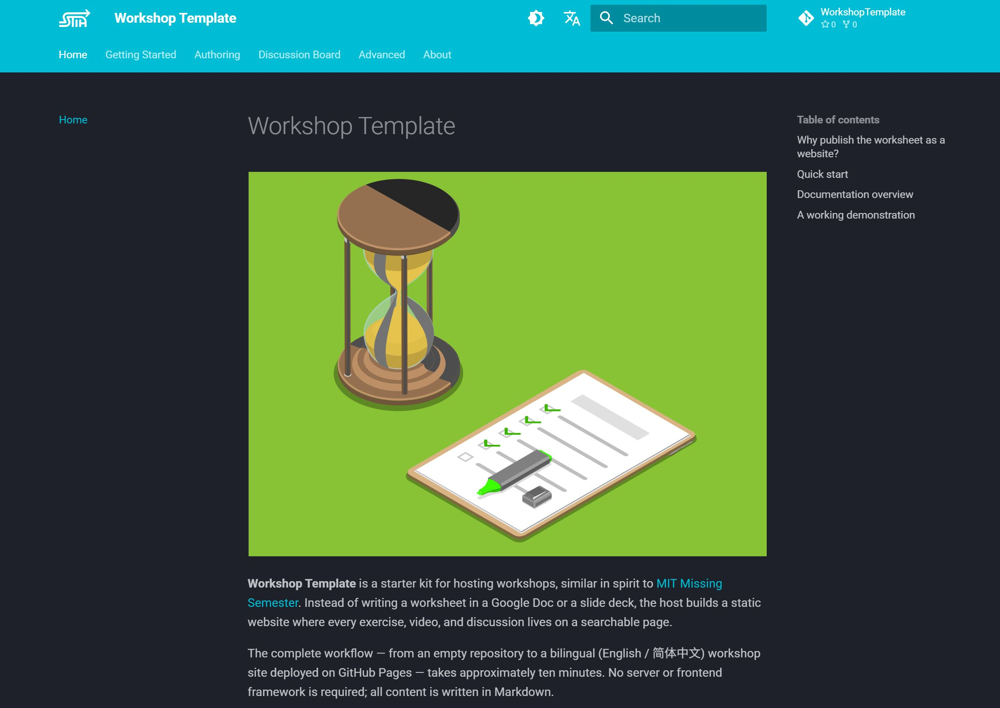

# Workshop Template



A starter kit for SSTIA workshop hosts: turn a worksheet into a bilingual static website with [MkDocs](https://www.mkdocs.org/), [Material for MkDocs](https://squidfunk.github.io/mkdocs-material/), and GitHub Pages.

## Features

- Bilingual (English / 简体中文) with a language switcher; the Chinese site is served under `/zh/`
- One-push deployment: GitHub Actions builds and publishes to GitHub Pages on every push to `main`
- Rich Markdown: tables, code blocks, admonitions, task lists, content tabs, emoji, LaTeX math, and Mermaid diagrams
- Per-page discussion board powered by [giscus](https://giscus.app) and GitHub Discussions
- Media embedding (images and videos) with bundled demo files
- Interactive widgets via raw HTML/CSS/JS — see the embedded Snake game demo
- CI health check: every pull request runs `mkdocs build --strict`, which fails on broken links
- Optional local preview with `mkdocs serve`

## Quick start

1. Click **Use this template** on this repository to create your own repository. Public visibility is required: GitHub Pages on free accounts and the giscus discussion board both need a public repository.
2. Allow the deploy workflow to write: **Settings → Actions → General → Workflow permissions → Read and write permissions**.
3. Edit `mkdocs.yml` (site name, `site_url`, `repo_url`) and commit. The first commit triggers the publish workflow.
4. Point GitHub Pages at the `gh-pages` branch: **Settings → Pages → Source → Deploy from a branch → `gh-pages` / `(root)`**.
5. Configure giscus for your repository; see the [Discussion Board](https://cedrichaskell.github.io/WorkshopTemplate/discussion/) page.

The site is then live at `https://<you>.github.io/<your-repo>/`.

## Documentation

The template's documentation is its own deployed site, which doubles as a working demonstration:

- [Workshop Template documentation](https://cedrichaskell.github.io/WorkshopTemplate/) (English)
- [Workshop Template 文档](https://cedrichaskell.github.io/WorkshopTemplate/zh/) (简体中文)

The Markdown sources live in `docs/en/` and `docs/zh/` in this repository.

## Local development

A local Python environment is needed only to preview the site:

```bash
python3 -m venv .venv
source .venv/bin/activate        # Windows: .venv\Scripts\activate
pip install -r requirements.txt
mkdocs serve                     # preview at http://localhost:8000
mkdocs build --strict            # CI runs this command on pull requests
```

## Repository layout

```
docs/en/                 English source (default language, built to the site root)
docs/zh/                 Chinese source (built to /zh/)
docs/assets/             shared images, videos, logo, and favicon
docs/overrides/          theme overrides (giscus comments template)
docs/scripts/hooks.py    build hooks
.github/workflows/       publish_site.yaml, health_check.yaml
mkdocs.yml               site configuration: navigation, theme, plugins, i18n
```
