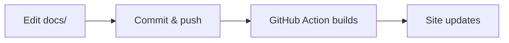

# Markdown Basics

The template supports standard Markdown plus the extensions listed in `markdown_extensions` in `mkdocs.yml` (tables, task lists, content tabs, admonitions, emoji, LaTeX math, Mermaid diagrams, and raw HTML). Every example on this page is rendered by the site itself; the source is shown in collapsible blocks.

## Text basics

```markdown
# Heading level 1
## Heading level 2
### Heading level 3

**bold**, *italic*, ***both***, ~~strikethrough~~, `inline code`

- unordered item
- another item
    - nested item (4 spaces)

1. ordered item
2. another item

[internal link](../getting-started/deployment.md)
[external link](https://www.mkdocs.org/)

> A blockquote.

---

A hard line break needs  
two trailing spaces.
```

- Headings `#`–`######` generate the table of contents on the right; hovering a heading reveals a permalink (the `¶` symbol), which is useful for linking to a specific section of the worksheet.
- Headings containing non-ASCII characters (e.g. Chinese) produce IDs with those characters stripped — often just a number such as `#1`. For stable, readable links, assign an explicit ID with the attribute syntax: `## Deploy steps {#deploy-steps}`, then link with `[jump](#deploy-steps)`.
- Internal links use paths relative to the current file, e.g. `../getting-started/deployment.md`. MkDocs converts them to the correct URL on every page, in both languages.
- A blank line is required between block elements; two trailing spaces produce a line break inside a paragraph.

## Tables

| Command | Function |
| --- | --- |
| `mkdocs serve` | Start a live preview server |
| `mkdocs build` | Build the static site into `site/` |
| `mkdocs build --strict` | Build and fail on broken links |

```markdown
| Command | Function |
| --- | --- |
| `mkdocs serve` | Start a live preview server |
| `mkdocs build` | Build the static site into `site/` |
| `mkdocs build --strict` | Build and fail on broken links |
```

The second row (`---`) is mandatory; column widths are computed automatically. Alignment is set with colons in the separator row (`:---`, `:---:`, `---:`).

## Code blocks

```python
def greet(name: str) -> str:
    """Return a friendly greeting."""
    return f"Hello, {name}!"
```

````markdown
```python
def greet(name: str) -> str:
    """Return a friendly greeting."""
    return f"Hello, {name}!"
```
````

- Fenced blocks with a language tag get syntax highlighting; the copy button in the top-right corner is enabled by the `content.code.copy` theme feature.
- To show a fence inside a code block (as above), use four backticks on the outer fence.

## Admonitions

!!! note "A note with a custom title"
    Notes present supplementary information.

!!! tip
    Tips suggest optional improvements.

!!! warning
    Warnings describe actions that may cause problems.

!!! danger "Heads-up"
    Danger blocks flag destructive operations.

```markdown
!!! note "A note with a custom title"
    Notes present supplementary information.

!!! tip
    Tips suggest optional improvements.

!!! warning
    Warnings describe actions that may cause problems.

!!! danger "Heads-up"
    Danger blocks flag destructive operations.
```

Other supported types: `info`, `success`, `failure`, `bug`, `example`, and `quote`. The syntax is `!!! type "optional title"` followed by an indented body.

## Collapsible blocks

??? example "Solution — click to reveal"
    Hiding solutions behind collapsible blocks is a common pattern for worksheets.

    ```python
    print("Hello, world!")
    ```

```markdown
??? example "Solution — click to reveal"
    Hiding solutions behind collapsible blocks is a common pattern for worksheets.
```

The block starts expanded with `???+ type` instead of `??? type`.

## Task lists

- [x] Fork the template repository
- [x] Enable GitHub Pages
- [ ] Write the worksheet
- [ ] Announce the workshop

```markdown
- [x] Fork the template repository
- [x] Enable GitHub Pages
- [ ] Write the worksheet
```

Checkboxes are rendered by `pymdownx.tasklist`. They are read-only in the browser — the checked state comes from the source file — which makes them suited to reading checklists and progress tracking in a worksheet.

## Content tabs

=== "Task"
    Create a page `docs/en/my-exercise.md` and register it in `nav`.

=== "Solution"
    !!! tip
        Do not forget the Chinese mirror in `docs/zh/`.

```markdown
=== "Task"
    Create a page `docs/en/my-exercise.md` and register it in `nav`.

=== "Solution"
    !!! tip
        Do not forget the Chinese mirror in `docs/zh/`.
```

Each `=== "Label"` starts a tab; the content is indented by four spaces and may contain any Markdown, including admonitions and code blocks. Content tabs are typically used to hide solutions behind a click.

## Emoji

The `pymdownx.emoji` extension renders shortcodes such as `:smile:` → :smile: and `:rocket:` → :rocket:, as well as `:material/rocket-launch:` icons from the Material icon set. A reference of shortcodes is available at [material icons search](https://squidfunk.github.io/mkdocs-material/reference/icons-emojis/).

## Math

Inline math uses `\( ... \)`: the mass–energy equivalence is \(E = mc^2\).

Display math uses `\[ ... \]`:

\[
\int_{-\infty}^{+\infty} e^{-x^2} \, dx = \sqrt{\pi}
\]

```markdown
Inline math uses `\( ... \)`: the mass–energy equivalence is \(E = mc^2\).

Display math uses `\[ ... \]`:

\[
\int_{-\infty}^{+\infty} e^{-x^2} \, dx = \sqrt{\pi}
\]
```

The formula is rendered by MathJax (the `pymdownx.arithmatex` extension generates the markup, `docs/javascripts/mathjax.js` supplies the configuration). Dollar-sign delimiters (`$...$`) are not enabled by default.

## Diagrams



````markdown

````

Mermaid syntax is documented at [mermaid.js.org](https://mermaid.js.org/); flowcharts, sequence diagrams, and Gantt charts are all supported.

## Raw HTML

The `md_in_html` extension passes HTML through to the page:

<div style="border: 1px solid var(--md-typeset-table-color); border-radius: 4px; padding: 0.5rem 1rem; display: inline-block;">
This paragraph is raw HTML inside Markdown.
</div>

```markdown
<div style="border: 1px solid var(--md-typeset-table-color); border-radius: 4px; padding: 0.5rem 1rem; display: inline-block;">
This paragraph is raw HTML inside Markdown.
</div>
```

This is the mechanism behind embedded widgets and games; see the [Game Demo](../advanced/game-demo.md) for a complete example.

## Frontmatter

Each page may begin with a YAML block:

```yaml
---
title: Browser-tab title          # optional; defaults to the H1
description: Summary for search results
discussions: true                 # enable the comment thread (see Discussion Board)
---
```

## More extensions

This template has already enabled the most common extensions. Further extensions can be added the same way — see [Customization](../advanced/customization.md), which walks through the pattern.
